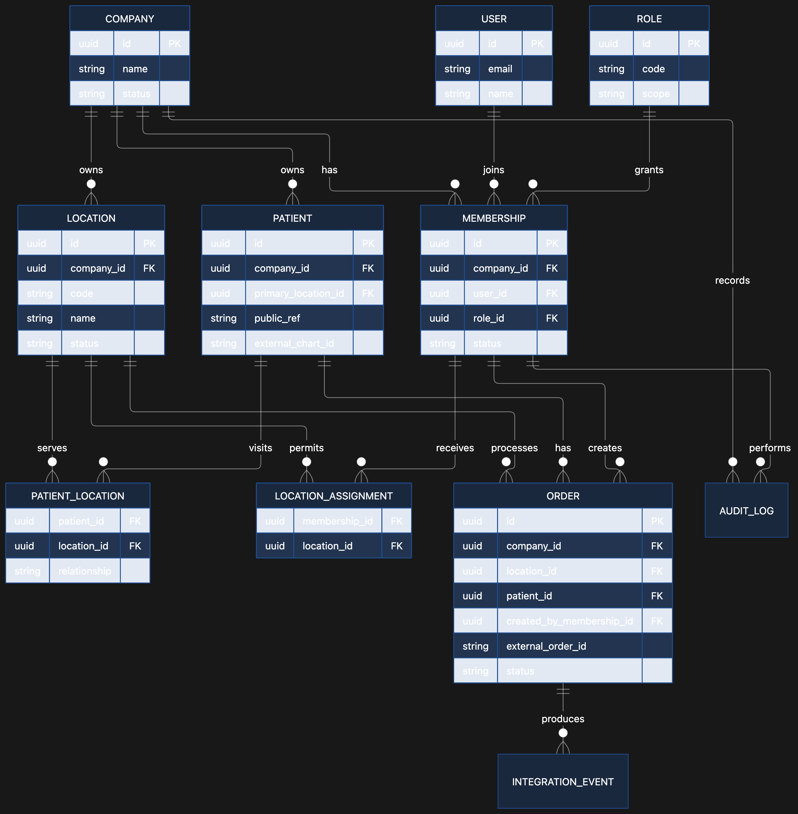

# Example Company API

Backend Golang/Gin cho mô hình multi-tenant trong ERD: company, location, user, role, membership, patient, location assignment, order, audit log và integration event.

## Mô hình dữ liệu



Phần mở rộng **Quản lý đợt điều trị** được mô tả tại [docs/care-journey.md](docs/care-journey.md). Kiến trúc cấu hình linh hoạt cho chuỗi nha khoa được mô tả tại [docs/flexible-dental-programs.md](docs/flexible-dental-programs.md).

## Có sẵn

- JWT access token + refresh token rotation + logout/revoke.
- RBAC với 3 role mặc định: `ADMIN`, `STAFF`, `CLINICIAN`.
- Tenant isolation theo `company_id`; `CLINICIAN` chỉ truy cập location được gán.
- CRUD đầy đủ cho company, location, custom role, membership, assignment, patient/location và order.
- Quản lý đợt điều trị gồm care journey, journey step, intake submission, intake file, renewal link và churn event.
- Chương trình điều trị nha khoa có version, step dependency, điều kiện rẽ nhánh, bước định kỳ và cấu hình riêng theo chi nhánh.
- Form và workflow có bản công bố bất biến; journey đang chạy luôn ghim vào đúng program/form version cũ.
- Mã trạng thái chuẩn phục vụ báo cáo toàn chuỗi, nhưng tên hiển thị và đường chuyển được cấu hình theo chương trình.
- Renewal token chỉ trả về một lần, chỉ lưu hash, giới hạn xác minh sai và chống double-submit.
- Pagination, search, status filter và validation request.
- Audit mọi request làm thay đổi dữ liệu.
- Transactional outbox cho `order.created`, `order.updated`, `order.deleted`; tự gửi webhook và retry exponential backoff.
- PostgreSQL migration, graceful shutdown, health check, JSON logging, Docker/Compose và unit test.
- CORS allowlist cấu hình bằng `CORS_ALLOWED_ORIGINS` (phân tách nhiều origin bằng dấu phẩy).

## Cấu trúc

```text
cmd/api/                 entrypoint
internal/config/         cấu hình từ environment
internal/database/       kết nối, auto-migrate, seed
internal/domain/         model và request/response DTO
internal/handler/        Gin handlers
internal/middleware/     auth, active-session, RBAC, audit, logging
internal/service/        nghiệp vụ và transaction
internal/outbox/         webhook dispatcher
internal/platform/       JWT và password helpers
internal/router/         khai báo route
migrations/              PostgreSQL up/down migration
```

## Chạy nhanh bằng Docker

```bash
docker compose up --build
```

API chạy tại `http://localhost:8080`. PostgreSQL chạy tại `localhost:5432`.

Nếu cổng mặc định đang được dùng:

```bash
API_PORT=18080 POSTGRES_PORT=55432 docker compose up --build
```

Khi đổi API port, đổi `baseUrl` trong `bruno/environments/Local.bru` hoặc truyền `--env-var baseUrl=http://localhost:18080` khi chạy Bruno CLI.

Để chạy trực tiếp:

```bash
cp .env.example .env
docker compose up -d postgres
go run ./cmd/api
```

Khi dùng database đã có schema từ migration, đặt `AUTO_MIGRATE=false`. Ở môi trường local mới hoàn toàn có thể dùng `AUTO_MIGRATE=true`.

## Luồng khởi tạo

Tạo company, user và membership ADMIN đầu tiên:

```bash
curl -X POST http://localhost:8080/api/v1/auth/register \
  -H 'Content-Type: application/json' \
  -d '{
    "company_name": "Acme Health",
    "name": "Admin User",
    "email": "admin@acme.test",
    "password": "ChangeMe123!"
  }'
```

Response trả `access_token`, `refresh_token`, user và membership. Các API bảo vệ dùng:

```bash
curl http://localhost:8080/api/v1/me \
  -H "Authorization: Bearer $ACCESS_TOKEN"
```

Khi một email có membership ở nhiều company, truyền `company_id` trong body `/auth/login` để chọn tenant.

## API

Base URL: `/api/v1`. Danh sách endpoint chính:

| Nhóm | Endpoint |
|---|---|
| Auth | `POST /auth/register`, `/auth/login`, `/auth/refresh`, `/auth/logout` |
| Profile | `GET/PATCH /me`, `PATCH /me/password` |
| Company | `GET/PATCH /company` |
| Location | `GET/POST /locations`, `GET/PATCH/DELETE /locations/:location_id` |
| Role | `GET/POST /roles`, `PUT/DELETE /roles/:role_id` |
| Membership | `GET/POST /memberships`, `GET/PATCH/DELETE /memberships/:membership_id` |
| Assignment | `GET/POST /memberships/:membership_id/locations`, `DELETE .../locations/:location_id` |
| Patient | `GET/POST /patients`, `GET/PATCH/DELETE /patients/:patient_id` |
| Patient location | `POST /patients/:patient_id/locations`, `DELETE .../locations/:location_id` |
| Treatment program | `GET/POST /treatment-programs`, `GET/PUT /treatment-programs/:program_id` |
| Program version | `POST /treatment-programs/:program_id/versions`, `POST /program-versions/:version_id/publish` |
| Program configuration | `POST /program-versions/:version_id/steps`, `PUT /step-templates/:id`, `POST .../dependencies`, `POST .../forms` |
| Program location | `PUT /treatment-programs/:program_id/locations` |
| Program runtime | `POST /treatment-programs/:program_id/instantiate` |
| Workflow | `GET/POST /workflows`, `POST /workflows/:workflow_id/publish` |
| Form template | `GET/POST /form-templates`, `POST /form-templates/:form_id/versions`, `POST /form-versions/:version_id/publish` |
| Care journey | `GET/POST /care-journeys`, `GET/PATCH /care-journeys/:journey_id` |
| Journey step | `POST /care-journeys/:journey_id/steps`, `PATCH /journey-steps/:step_id` |
| Journey lifecycle | `POST /care-journeys/:journey_id/churn-events` |
| Intake | `GET/POST /intake-submissions`, `GET /intake-submissions/:submission_id`, `POST .../files` |
| Renewal admin | `GET/POST /journey-steps/:step_id/renewal-links` |
| Renewal public | `POST /public/renewal-links/:token/open`, `POST .../:token/submit` |
| Order | `GET/POST /orders`, `GET/PATCH/DELETE /orders/:order_id` |
| Audit | `GET /audit-logs`, `GET /audit-logs/:audit_log_id` |
| Outbox | `GET /integration-events`, `POST /integration-events/:event_id/retry` |
| Health | `GET /health/live`, `GET /health/ready` |

List endpoint hỗ trợ `page` và `page_size` (tối đa 100). Tùy resource còn có `search`, `status`, `location_id`, `patient_id`, `from`, `to`.

### Quyền

- `ADMIN/company`: quản trị company, location, role, membership, assignment, audit và outbox; có toàn quyền dữ liệu tenant.
- `STAFF/company`: thao tác patient/order và đọc location trong toàn company.
- `CLINICIAN/location`: chỉ đọc và thao tác patient/order thuộc location đã được gán.
- Role custom được hỗ trợ; middleware đặc quyền quản trị hiện yêu cầu code `ADMIN`. Các role mặc định không thể sửa/xóa.

Membership bị inactive, user bị inactive hoặc company bị inactive sẽ bị chặn ngay ở request kế tiếp, kể cả access token chưa hết hạn.

## Quy tắc dữ liệu

- `location.code`, `patient.public_ref`, `order.external_order_id` là duy nhất trong company.
- Khi admin thêm membership cho email chưa tồn tại, request phải kèm `name` và `password`; email đã tồn tại chỉ cần `email`, `role_id` và `status`.
- Company luôn phải còn ít nhất một membership `ADMIN` active.
- Patient phải liên kết với location trước khi tạo order ở location đó.
- Không xóa cứng location/patient/membership đang được order tham chiếu; chuyển `status=inactive` để giữ lịch sử.
- Delete ở entity chính là soft delete; bảng nối được hard delete.
- Thay đổi order và integration event được ghi chung một database transaction (outbox pattern).
- Mỗi patient chỉ có một journey `ONBOARDING`, `ACTIVE` hoặc `PAUSED` trong cùng program.
- Program version, form version và workflow đã publish là bất biến; muốn thay đổi phải tạo bản nháp/bản mới.
- Dependency của step không được tạo chu trình; form bắt buộc phải được submit trước khi hoàn tất step.
- Điều kiện rẽ nhánh chỉ là JSON data (`field`, `operator`, `value`), không cho lưu hoặc chạy script tự do.
- `journey_steps.step_key` là duy nhất trong journey; order liên kết step phải cùng patient/location/company.
- Intake đã submit là bất biến; submit lại renewal token trả về submission cũ thay vì tạo trùng.
- Churn event là append-only; churn sẽ đóng journey, hủy step chưa hoàn tất và revoke link còn hiệu lực trong cùng transaction.

## Webhook integration

Đặt `INTEGRATION_WEBHOOK_URL`. Dispatcher gửi JSON của order với headers:

- `X-Event-ID`
- `X-Event-Type`
- `Content-Type: application/json`

HTTP `2xx` được đánh dấu `published`; lỗi được retry tối đa theo lịch exponential backoff. Admin có thể đưa event về hàng đợi qua endpoint retry.

## Migration và kiểm thử

Apply thủ công:

```bash
psql "$DATABASE_URL" -f migrations/000001_init.up.sql
psql "$DATABASE_URL" -f migrations/000002_care_journeys.up.sql
psql "$DATABASE_URL" -f migrations/000003_flexible_programs.up.sql
```

Nếu PostgreSQL Docker volume đã tồn tại từ trước khi có module care journey, apply migration mới rồi restart API:

```bash
make migrate-care-journeys
make migrate-flexible-programs
docker compose restart api
```

Không cần chạy các lệnh migration thủ công với database mới vì Docker tự apply cả ba migration khi khởi tạo volume lần đầu.

Kiểm tra code:

```bash
go test ./...
go vet ./...
```

Các secret trong `.env.example` và `docker-compose.yml` chỉ dùng local; production phải thay `JWT_SECRET`, credential database và dùng TLS/secrets manager.

## Test API bằng Bruno

Project có sẵn collection tại thư mục `bruno/`, gồm 51 request chạy tuần tự: health check, auth, tenant, patient, care journey, renewal, order, audit và một kịch bản Implant đầy đủ. Kịch bản nha khoa tự tạo workflow/form/program version, publish, instantiate, submit form, chuyển trạng thái, mở dependency và kiểm tra cả hai nhánh cần/không cần ghép xương. Token cùng các ID được tự động lưu thành runtime variables.

### Bruno Desktop

Trên macOS, cài bằng Homebrew:

```bash
brew install --cask bruno
```

Sau đó:

1. Chạy API bằng `docker compose up --build`.
2. Mở Bruno, chọn **Open Collection**.
3. Chọn thư mục `bruno` của project.
4. Chọn environment **Local** ở góc trên bên phải.
5. Chạy từng request theo số thứ tự, hoặc chọn **Run Collection** để chạy toàn bộ.

### Bruno CLI

Bruno CLI được khai báo là dev dependency trong `package.json`. Sau khi clone project:

```bash
npm ci
npm run test:api
```

Hoặc:

```bash
make bruno-install
make test-api
```

Nếu API chạy ở cổng khác:

```bash
cd bruno
../node_modules/.bin/bru run --env Local \
  --env-var baseUrl=http://localhost:18080
```

Collection tạo email và mã tham chiếu động nên có thể chạy lại nhiều lần mà không trùng unique key. Hướng dẫn cài đặt chính thức: [Bruno Desktop](https://docs.usebruno.com/get-started/bruno-basics/download) và [Bruno CLI](https://docs.usebruno.com/bru-cli/installation).
