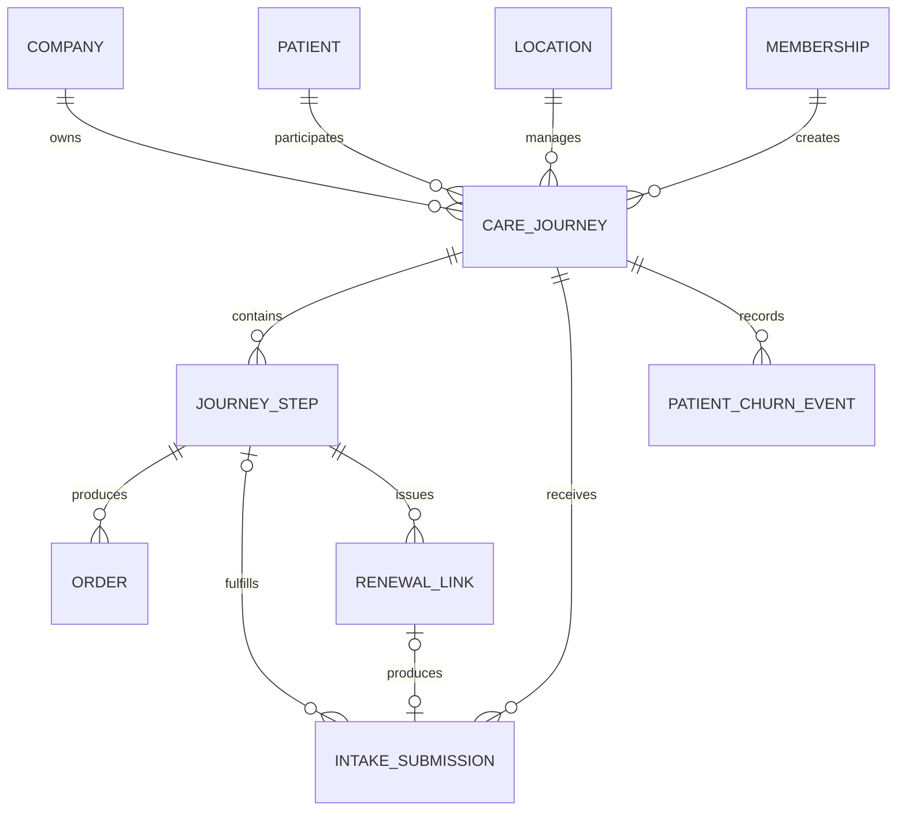

# Quản lý đợt điều trị

Module này quản lý toàn bộ vòng đời điều trị của một bệnh nhân trong một chương trình như TRT hoặc GLP-1.



## Thành phần

| Thành phần | Trách nhiệm |
|---|---|
| `care_journeys` | Trạng thái tổng hợp của một episode điều trị |
| `journey_steps` | Công việc hoặc milestone cần thực hiện |
| `intake_submissions` | Snapshot bất biến của phiếu bệnh nhân đã gửi |
| `intake_files` | Metadata của file gắn với submission |
| `renewal_links` | Token, xác minh và lifecycle của link tái khám |
| `patient_churn_events` | Lịch sử append-only khi ngừng, quay lại hoặc hoàn tất |

## Trạng thái

Journey:

```text
ONBOARDING → ACTIVE ↔ PAUSED → COMPLETED
                       ├────→ CHURNED
                       └────→ CANCELLED
```

Step:

```text
PENDING → WAITING_PATIENT → IN_REVIEW → READY → SUBMITTED → COMPLETED
             ├────────────→ EXPIRED
             ├────────────→ REJECTED
             └────────────→ CANCELLED
```

Renewal link:

```text
ISSUED → OPENED → SUBMITTED → COMPLETED
  ├────→ EXPIRED
  ├────→ REVOKED
  └────→ LOCKED
```

## Invariant chính

- Một patient chỉ có một journey đang `ONBOARDING`, `ACTIVE` hoặc `PAUSED` trong cùng program.
- `step_key` là duy nhất trong một journey.
- Mọi entity phải cùng `company_id`; location-scoped membership chỉ truy cập location được gán.
- Order liên kết journey step phải cùng patient và location với journey.
- Answers của intake đã submit không có API update hoặc delete.
- Token renewal thật chỉ trả về lúc issue; database chỉ lưu SHA-256 hash.
- Dữ liệu xác minh renewal được lưu dưới dạng bcrypt hash.
- Link mới tự revoke link cũ còn hiệu lực của cùng step.
- Sai xác minh quá `max_attempts` sẽ khóa link.
- Submit lại cùng token trả về submission đã có, không tạo record thứ hai.
- Churn event không có API update/delete.
- Churn journey, cancel step và revoke link được thực hiện trong cùng transaction.

## Luồng renewal

```text
Tạo renewal step
    ↓
Issue renewal link (token chỉ xuất hiện một lần)
    ↓
Bệnh nhân mở link và xác minh
    ↓
Bệnh nhân submit answers
    ↓
Tạo intake submission bất biến
    ↓
Step chuyển IN_REVIEW
    ↓
Journey chuyển PROVIDER_REVIEW
    ↓
Provider tạo order liên kết journey step
```

## API

```text
GET    /api/v1/care-journeys
POST   /api/v1/care-journeys
GET    /api/v1/care-journeys/:journey_id
PATCH  /api/v1/care-journeys/:journey_id
POST   /api/v1/care-journeys/:journey_id/steps
POST   /api/v1/care-journeys/:journey_id/churn-events
PATCH  /api/v1/journey-steps/:step_id

GET    /api/v1/intake-submissions
POST   /api/v1/intake-submissions
GET    /api/v1/intake-submissions/:submission_id
POST   /api/v1/intake-submissions/:submission_id/files

GET    /api/v1/journey-steps/:step_id/renewal-links
POST   /api/v1/journey-steps/:step_id/renewal-links
POST   /api/v1/public/renewal-links/:token/open
POST   /api/v1/public/renewal-links/:token/submit
```
