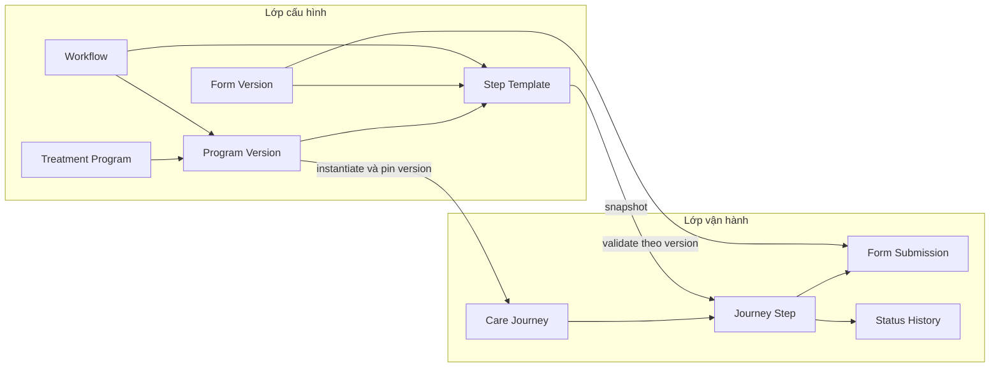

# Chương trình điều trị linh hoạt cho chuỗi nha khoa

Thiết kế chia dữ liệu thành hai lớp để một chuỗi có thể cấu hình nhiều quy trình nha khoa mà không phải sửa code cho từng dịch vụ.

## Hai lớp dữ liệu



- **Lớp cấu hình** do ADMIN xây dựng, kiểm tra và publish.
- **Lớp vận hành** là đợt điều trị thật của bệnh nhân, không tự đổi theo cấu hình mới.
- Bản đã publish là bất biến. Thay đổi quy trình bằng cách tạo program version mới.

## Thành phần và nhiệm vụ

| Thành phần | Nhiệm vụ |
|---|---|
| `treatment_programs` | Danh mục dịch vụ như Implant, niềng răng, răng sứ |
| `program_versions` | Phiên bản bất biến của một chương trình; giữ current published version |
| `step_templates` | Mẫu bước, role phụ trách, deadline, lặp, điều kiện và workflow |
| `step_dependencies` | Đồ thị phụ thuộc giữa các bước; hệ thống từ chối cycle |
| `program_locations` | Bật/tắt chương trình và cấu hình override theo chi nhánh |
| `form_templates/form_versions` | Phiếu có version, schema dạng dữ liệu và validation |
| `step_form_assignments` | Gắn form vào trước/trong/sau bước và xác định người điền |
| `workflow_templates/states/transitions` | Tên hiển thị và đường chuyển của các mã trạng thái chuẩn |
| `care_journeys` | Aggregate của một đợt điều trị; pin `program_version_id` |
| `journey_steps` | Bản thực tế sinh từ step template; có iteration cho bước lặp |
| `intake_submissions` | Snapshot câu trả lời, pin `form_version_id` |
| `status_histories` | Lịch sử chuyển trạng thái append-only |

## Ví dụ Implant có rẽ nhánh

```text
Khám + chụp CT
        ↓
needs_bone_graft == true?
├── Có    → Ghép xương → Chờ lành thương → Cấy trụ
└── Không → Cấy trụ
```

Điều kiện được lưu dưới dạng JSON an toàn:

```json
{
  "field": "needs_bone_graft",
  "operator": "equals",
  "value": true
}
```

Các operator hiện có: `equals`, `not_equals`, `exists`, `in`. Hệ thống không lưu hoặc thực thi JavaScript/script trong điều kiện hay form schema.

## Versioning

1. ADMIN tạo program và program version ở trạng thái `DRAFT`.
2. Thêm step, dependency, form và workflow.
3. Publish chỉ thành công khi graph hợp lệ và các form liên quan không còn draft.
4. Program version cũ chuyển `RETIRED`, nhưng journey cũ vẫn dùng nó.
5. Form version retired vẫn nhận submission của journey cũ; bệnh nhân mới dùng bản published hiện tại.

Khi tạo version tiếp theo, các step, dependency và form assignment hiện tại được clone sang draft mới. ADMIN chỉnh draft rồi publish, không sửa dữ liệu mà bệnh nhân đang dùng.

## Trạng thái chuẩn

Journey dùng các code:

```text
DRAFT, ONBOARDING, ACTIVE, PAUSED, COMPLETED, CHURNED, CANCELLED
```

Step dùng các code:

```text
NOT_STARTED, READY, WAITING_PATIENT, IN_PROGRESS, WAITING_DOCTOR,
BLOCKED, COMPLETED, SKIPPED, CANCELLED
```

Mỗi workflow được đổi `display_name` sang ngôn ngữ/ngữ cảnh phù hợp, nhưng `code` và `standard_code` phải giữ chuẩn để báo cáo giữa các chi nhánh không bị sai nghĩa.

## Khởi tạo và vận hành

`POST /api/v1/treatment-programs/:program_id/instantiate` thực hiện trong một transaction:

1. Kiểm tra tenant, patient, location và program có được bật tại chi nhánh.
2. Lấy current published version và pin vào journey.
3. Tạo snapshot tất cả journey step.
4. Step không thỏa điều kiện thành `SKIPPED`.
5. Step không có dependency đang áp dụng thành `READY`; step còn lại là `NOT_STARTED`.
6. Khi step hoàn tất, hệ thống mở các step đã đủ dependency.
7. Step `INTERVAL` sinh iteration tiếp theo theo `repeat_interval_days` và `max_occurrences`.

Một patient chỉ được có một journey đang `ONBOARDING`, `ACTIVE` hoặc `PAUSED` cho cùng program. Muốn bắt đầu episode mới phải kết thúc/hủy/churn episode đang hoạt động trước.

## File code chính

| File | Trách nhiệm |
|---|---|
| `internal/domain/program_models.go` | Model cấu hình và status history |
| `internal/domain/program_dto.go` | DTO/validation cho API cấu hình |
| `internal/service/program.go` | Version, step, dependency và location override |
| `internal/service/configuration.go` | Workflow, form schema và publish |
| `internal/service/program_runtime.go` | Instantiate, condition, transition, unlock và repeat |
| `internal/handler/program.go` | HTTP handler của module |
| `migrations/000003_flexible_programs.up.sql` | Schema PostgreSQL |
| `bruno/11 Flexible Dental Programs/` | Kịch bản API Implant end-to-end |

## API cấu hình chính

```text
GET    /api/v1/treatment-programs
POST   /api/v1/treatment-programs
GET    /api/v1/treatment-programs/:program_id
PUT    /api/v1/treatment-programs/:program_id
POST   /api/v1/treatment-programs/:program_id/versions
PUT    /api/v1/treatment-programs/:program_id/locations
POST   /api/v1/program-versions/:version_id/steps
POST   /api/v1/program-versions/:version_id/publish
PUT    /api/v1/step-templates/:step_template_id
POST   /api/v1/step-templates/:step_template_id/dependencies
POST   /api/v1/step-templates/:step_template_id/forms

GET    /api/v1/workflows
POST   /api/v1/workflows
POST   /api/v1/workflows/:workflow_id/publish

GET    /api/v1/form-templates
POST   /api/v1/form-templates
POST   /api/v1/form-templates/:form_id/versions
POST   /api/v1/form-versions/:version_id/publish

POST   /api/v1/treatment-programs/:program_id/instantiate
```
